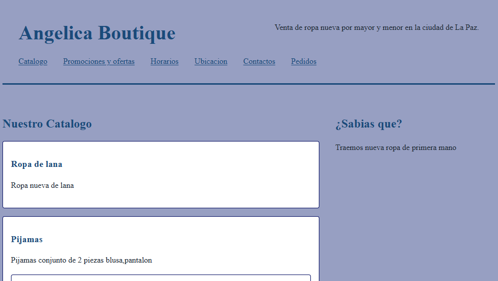

# [TIENDA DE ROPA "ANGELICA BOUTIQUE"]

**Estudiante:** Miguel Angel Kato Ortiz  
**Cliente:** Angelica Ortiz Choquehuanca  
**Ciudad:** La Paz, Bolivia  
**URL publicada:** [DESPUES, PROXIMA SEMANA]

## Qué resuelve
- Digitaliza y moderniza la venta de ropas nuevas de primera mano por mayor y menor.
- Permite cotizar y realizar pedidos de manera fácil, rápida y directa (incluyendo checkout interactivo por WhatsApp) mediante un catálogo dinámico con filtros por categoría y búsqueda en tiempo real.
- Aplica automáticamente descuentos comerciales por volumen (15% de descuento en pedidos mayoristas a partir de 6 unidades).

## Cómo está construido
- **Semántica HTML5:** Documento estructurado con `<!DOCTYPE html>`, `<html lang="es">`, `<header>`, `<nav>`, `<main>`, `<section>`, `<article>`, `<table>`, `<figure>`, `<form>`, `<fieldset>`, `<legend>`, `<aside>`, `<footer>` y `<address>`.
- **Layout y CSS Moderno:** 
  - **Flexbox:** Distribución de cabecera, barra de navegación, controles de filtro, alineaciones de tarjetas y botones de acción.
  - **CSS Grid:** Distribución de tarjetas dinámicas en el catálogo (`#lista-productos`) y la maqueta general del sitio en pantallas de escritorio con `grid-template-areas`.
  - **Custom Properties (Variables CSS):** Paleta unificada con azul corporativo (`--color-principal`), terracota cálido (`--color-acento`), verde teal (`--color-teal`), fondos neutros y sombras suaves.
- **JavaScript y jQuery (Archivos del proyecto):**
  - [datos.js](datos.js): Catálogo oficial de prendas (ropa de lana, pijamas, poleras), clases ES6 (`Producto`, `ProductoConDescuento`) y métodos de consulta.
  - [funciones.js](funciones.js): Funciones puras de cálculo comercial: cálculo de subtotales, descuento mayorista automático (15% para ≥6 unidades), formateo de moneda en bolivianos (Bs) e integración con la API de WhatsApp.
  - [app.js](app.js): Configuración principal de Angelica Boutique y actualización dinámica del estado del catálogo en la cabecera.
  - [render.js](render.js): Módulo de manipulación y renderizado optimizado del DOM utilizando `DocumentFragment`, con etiquetas de disponibilidad e incentivos mayoristas.
  - [eventos.js](eventos.js): Búsqueda en vivo (`input`), filtro por categorías con delegación de eventos, carga dinámica del selector de prendas, cotizador en vivo en el formulario y envío directo por WhatsApp y confirmación en pantalla.
  - [jquery-panel.js](jquery-panel.js): Menú móvil desplegable con `.slideToggle()`, panel acordeón interactivo de preguntas frecuentes y animaciones suaves.

## Capturas
  
 DESPUES, PROXIMA SEMANA

## Lo más difícil
La alineación y adaptabilidad de los componentes dinámicos con CSS Grid y Flexbox, la unificación de los datos del catálogo para que se integren directamente con el cotizador en vivo del formulario de pedidos, y la integración de eventos jQuery para el menú móvil y el acordeón interactivo sin conflictos de scripts.
